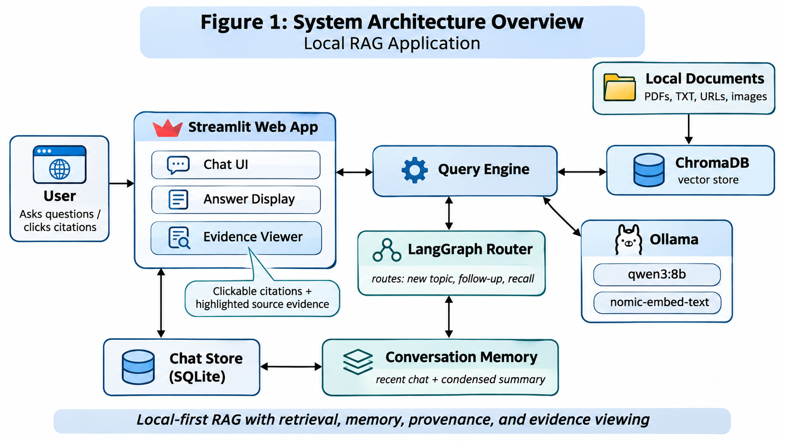
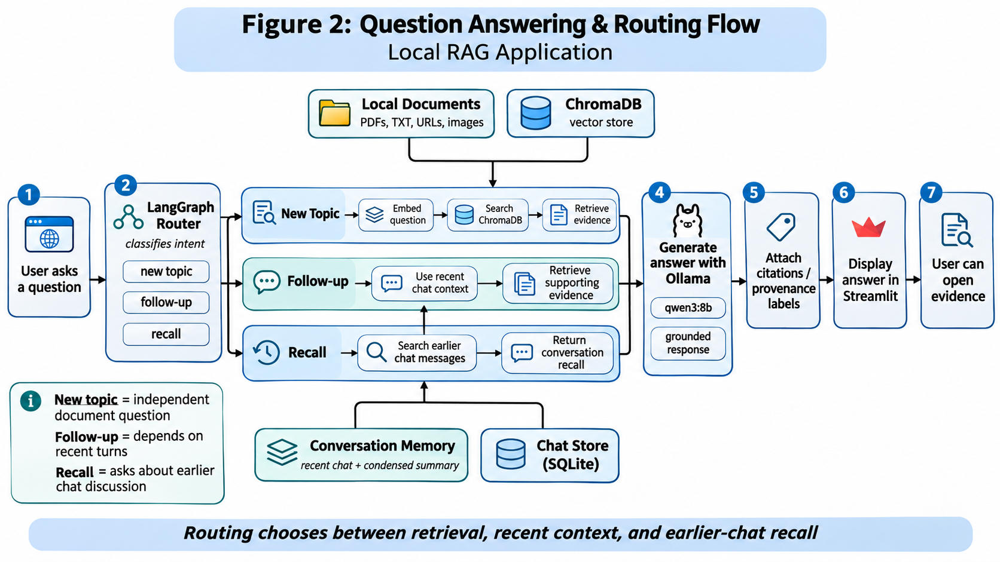
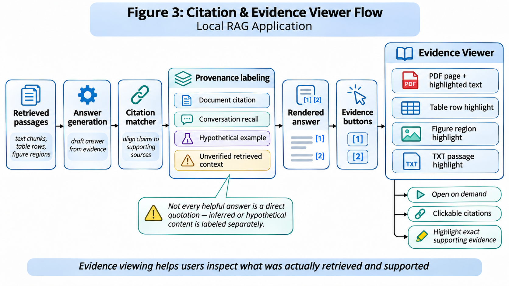
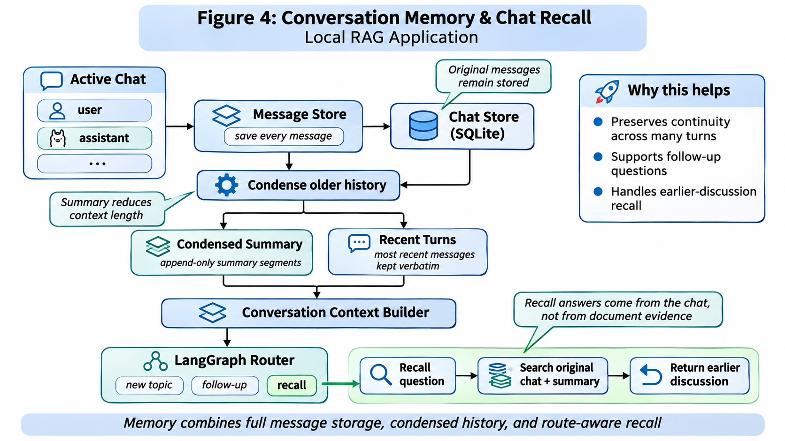

# Local RAG Search Engine

A locally running **retrieval-augmented generation (RAG)** search application built with Python, [Ollama](https://ollama.com/), [ChromaDB](https://www.trychroma.com/), [Streamlit](https://streamlit.io/), and [LangGraph](https://www.langchain.com/langgraph).

Index local TXT/PDF documents, images, and webpages, then ask questions using a local language model. The system supports structured PDF table lookup, figure descriptions, clickable source evidence, persistent conversation history, and context-aware questions.

> **Status:** Functional research/development prototype. Not production-hardened; retrieved sources and displayed citations do not guarantee that every generated claim is correct. This is not yet a native desktop installer.

## Features

- **Inputs:** TXT, PDF, PNG, JPG/JPEG, WebP, and webpages.

- **Local models:** `nomic-embed-text` embeddings, `qwen3:8b` answers, and `qwen3-vl:8b` image descriptions (configurable).

- **Persistent knowledge base:** ChromaDB collection `documents` in `data/chroma/`.

- **PDF support:** Text extraction, figure cropping/description/validation, and structured table extraction and validation.

- **Source-aware table references:** Supports numeric references (such as Table 3) and legacy Roman numerals (such as Table II).

- **Exact table operations:** Certain structured table listings and numerical rankings are handled directly in Python rather than reconstructed by a language model.

- **Neighboring-chunk retrieval:** Adds nearby passages when a relevant explanation spans several chunks.

- **Conversation routing:** LangGraph routes new-topic, follow-up, and earlier-chat recall questions.

- **Persistent chats and memory:** SQLite-backed conversations, chat switching/deletion, and append-only condensed summary segments alongside original messages.

- **Evidence viewer and provenance:** Clickable source references and PDF/TXT evidence viewing; separately labels answer type (e.g., hypothetical example or conversation recall) and evidence status. Some sources are explicitly marked unverified.

- **Interfaces:** Streamlit web app and command-line questions.

- **Diagnostics:** Core offline regression tests, legacy fixture/live regression tests, retrieval evaluation, and optional profiling.

Source references may include filenames, pages, table/figure numbers, and chunk references. A matched passage is **not** the same as independently verified claim-level attribution.

## Architecture

The Local RAG Search Engine combines local document indexing, semantic retrieval, LangGraph-based conversation routing, persistent memory, and source-aware answer generation.

### System overview



### Document indexing

The indexing pipeline processes different content types:

- **TXT, PDF, and webpages:** Extract and chunk text.

- **Images:** Generate searchable descriptions using a vision model.

- **PDF figures:** Crop, describe, and validate figures.

- **PDF tables:** Extract, structure, and validate table content.

The processed content is embedded using `nomic-embed-text` and stored in ChromaDB for semantic retrieval.

### Question answering and LangGraph routing



LangGraph uses three routes:

- **New topic:** Retrieve evidence from indexed documents.

- **Follow-up:** Resolve questions using recent conversation context and supporting document evidence when applicable.

- **Recall:** Recover information from earlier discussion, distinctly labeled as conversation memory rather than independently verified paper evidence.

The query engine also supports source-aware table and figure lookup, including some deterministic table-answering operations. Routing rules are heuristic and have known limitations on ambiguous questions.

### Citations and evidence verification



The application provides clickable references, PDF/TXT evidence viewing and highlighting where feasible, and provenance labels. It distinguishes document-supported responses, conversation recall, reasoned inference, and hypothetical illustrations. If a claim-level match is unavailable, it labels the retrieved source as **unverified**, not as a validated citation.

### Persistent conversation memory



SQLite retains the original messages for each chat. Older conversation sections are condensed into append-only memory segments while recent messages remain available verbatim. The recall workflow can use both summaries and original conversation history. Segment append behavior was tested; perfect long-term recall is not guaranteed.

## Requirements

The automated setup scripts install the Python environment, Python dependencies, and Ollama if needed. You do **not** have to install these manually before running the setup script, except where the script prompts for a system prerequisite or permission.

- Windows 10/11 with PowerShell and `winget` available (tested on Windows 11 using Python 3.14).
- macOS (tested on Apple Silicon using Python 3.12; Homebrew may be installed with your approval).
- Ubuntu 24.04 LTS for the Linux script (x86-64 or ARM64; not yet tested).
- Sufficient memory and disk space for the language models, document index, and installation files.
- Internet access during first-time installation and for optional webpage indexing.

The default models are `nomic-embed-text` for embeddings, `qwen3:8b` for responses, and `qwen3-vl:8b` for image and figure descriptions. Setup downloads the required models automatically. Vision processing requires additional resources, while text-only querying primarily uses the embedding and answer models.

## Installation

Clone the repository in PowerShell (Windows) or Terminal (macOS/Linux):

```bash
git clone https://github.com/MosesNde/local-rag-search.git
cd local-rag-search
```

Run the setup script for your operating system **once**.

**Windows (tested):**

```powershell
powershell -ExecutionPolicy Bypass -File .\setup-windows.ps1
```

**macOS — Apple Silicon (tested):**

```bash
bash setup-macos.sh
```

**Ubuntu 24.04 LTS (not yet tested):**

```bash
bash setup-linux.sh
```

Setup creates an isolated Python environment, installs `requirements.txt`, starts Ollama, checks or downloads the AI models, and launches LUCY. It may require OS administrator approval. Models can require several gigabytes of downloads. Setup does not delete existing document indexes or conversation history.

See [SETUP_README.md](SETUP_README.md) for detailed setup information.

### Starting LUCY after installation

**You do not need to reinstall LUCY when you close it.** Use the launcher supplied for your operating system:

| Operating system | Start LUCY again | Notes |
| --- | --- | --- |
| Windows | Double-click `START_APP.vbs` | Tested with the new setup environment; launches without a visible terminal. |
| macOS | Double-click `START_APP.command` | May first require `chmod +x START_APP.command` in Terminal; launcher not yet tested. |
| Ubuntu Linux | Run `bash CREATE_LINUX_SHORTCUT.sh` once, then open the created desktop shortcut | Shortcut creation and startup not yet tested. |

The launchers reuse the installed Python environment and Ollama models; they do **not** reinstall packages or download models. Open <http://localhost:8501> to access LUCY. If the app server is still running after you close the browser tab, you can simply reopen that address. To fully stop LUCY, stop its running Streamlit process; on Windows you can also use `STOP_APP.vbs` to request shutdown.

### Model configuration

`src/config.py` reads these environment variables:

| Variable | Default | Purpose |
| --- | --- | --- |
| `OLLAMA_HOST` | `http://127.0.0.1:11434` | Ollama endpoint setting |
| `EMBEDDING_MODEL` | `nomic-embed-text` | Text embeddings |
| `ANSWER_MODEL` | `qwen3:8b` | Answer generation |
| `VISION_MODEL` | `qwen3-vl:8b` | Image/figure descriptions |
| `VISION_CONTEXT_SIZE` | `8192` | Vision context configuration |
| `VISION_MAX_RETRIES` | `1` | Vision retry configuration |

## Add content

| Content | Local path |
| --- | --- |
| TXT and PDF files | `data/documents/` |
| PNG, JPG/JPEG, WebP images | `data/images/` |
| Webpage URLs (one per line) | `data/urls.txt` |

Example `data/urls.txt`:

```text

https://docs.python.org/3/tutorial/introduction.html
```

Run the main indexer from the project root:

```powershell

python .\src\index_documents.py
```

The indexer creates local data directories and stores records in the persistent ChromaDB collection `documents`. Sources already indexed are normally skipped; modified and deleted source files are **not** automatically synchronized.

### PDF table and figure pipelines

The codebase includes dedicated modules:

- **Figures:** `src/pdf_figures.py`, `src/pdf_pipeline.py`, and `src/pdf_validation.py` detect/crop, describe, and validate PDF figures.

- **Tables:** `src/pdf_tables.py`, `src/pdf_table_pipeline.py`, and `src/pdf_table_validation.py` extract and validate structured records.

- **Legacy/specialized scripts:** `src/index_pdf_figures.py` and `src/index_pdf_tables.py` were developed for earlier indexing workflows; use the integrated pipeline for ordinary indexing.

For an individual PDF figure-processing run:

```powershell

python .\src\pdf_pipeline.py --pdf example.pdf
```

For table extraction/validation **without ChromaDB writes**:

```powershell

python .\src\pdf_table_pipeline.py example.pdf
```

For explicit table indexing:

```powershell

python .\src\pdf_table_pipeline.py example.pdf --index
```

Place `example.pdf` in `data/documents/` or supply a valid path. Extraction and validation are heuristic and do not guarantee perfect correspondence with the rendered PDF.

## Web interface

The setup and startup launchers open LUCY's Streamlit web interface. If your browser does not open automatically, visit <http://localhost:8501>.

If you prefer to run Streamlit directly, use the Python executable in the environment created by setup:

**Windows (new Python 3.14 installation):**

```powershell
.\.venv-lucy-314\Scripts\python.exe -m streamlit run src/web_app.py
```

If Windows setup used `.venv-lucy` instead, substitute `.venv-lucy` in that command.

**macOS or Ubuntu:**

```bash
.venv-lucy/bin/python -m streamlit run src/web_app.py
```

The web interface supports document/image uploads, URL entry, indexing, questions, persistent SQLite-backed chats, switching between chats, clearing/deleting saved chats, clickable citations, source previews, and a conversation-memory diagnostics panel. Questions run through the LangGraph router; conversation history and summaries are kept separately for each chat.

The web interface is intended for **trusted local use**, not exposure directly to the public internet. Conversations are saved locally and persist after closing the browser until deleted.

## Command-line questions

```powershell

python .\src\query_documents.py
```

Example questions (which require the relevant documents to have been indexed):

```text

What is retrieval-augmented generation?
According to Table II of the OWASP vulnerability dataset paper, list all OWASP categories and their most affected programming languages.
What does Figure 3 in agentchaos.pdf show?
```

When sufficient evidence exists, the output includes an answer and source references. For some exact structured table requests, Python produces the answer without an LLM call. **The direct CLI entry point is primarily single-question retrieval**; persistent multi-turn conversations are provided by the Streamlit UI.

## Evaluation and diagnostics

### Core regression tests (offline)

```powershell

python .\src\test_rag_core_regression.py
```

The core suite tests LangGraph dispatch with a fake backend, cumulative memory behavior, provenance classification, and example-request recognition. It does not require running Ollama or Streamlit, and does not write to ChromaDB or SQLite. **At the November 2026 Windows checkpoint, all 10 tests passed.** These mocked tests do not establish end-to-end retrieval or answer correctness.

### PDF/table fixture regression and live tests

```powershell

python .\src\test_rag_regression.py
python .\src\test_rag_regression.py --live
```

These older tests rely on local extracted-table fixtures; `--live` additionally requires an existing indexed development corpus and running Ollama. At the October 2026 development checkpoint, **3 fixture tests and 4 live tests passed**. These results are historical and are not a general RAG benchmark. A fresh clone does not contain the local fixtures or corpus needed by that suite.

### Retrieval evaluation and profiling

Evaluate evidence retrieval:

```powershell

python .\src\evaluate_retrieval_quality.py
```

Generated reports are saved under `data/retrieval_tests/`. Some evaluator tests use generic semantic retrieval, so their scores are not equivalent to testing the application's full table-aware route.

Enable optional per-stage profiling:

```powershell

$env:RAG_PROFILE = "1"
python .\src\query_documents.py
```

## Privacy and data handling

Ollama inference and ChromaDB indexing/storage operate locally by default. Downloading packages/models and indexing webpages require external network access. Only retrieve and index content you are authorized to process.

Local documents, images, ChromaDB records, extracted figures/tables, generated reports, **SQLite chats (`data/chat_history.sqlite3`)**, and local evaluation data are excluded from Git using `.gitignore`. **Cloning this repository does not download the development corpus, database, or saved conversations.** Review any documents and logs before deliberately sharing them.

## Known limitations

- PDF layouts, figures, tables, and vision-generated descriptions may be incomplete or inaccurate.

- Structural validation does not certify every extracted cell against the original PDF.

- Chunking is simple; neighboring-chunk expansion reduces but does not eliminate missing-context problems.

- Grounded answers can still be incomplete or incorrect; matched sources are not guaranteed claim-level verification.

- Some citation links can only open unverified source previews when exact text or regions cannot be matched.

- Ambiguous table references across documents may require a clearer source name.

- Existing ChromaDB records are not automatically updated when source files change or are removed.

- LangGraph routing uses heuristics and may misclassify ambiguous questions or context-dependent requests.

- Chat memory uses recent messages, append-only summaries, and retained original messages. Summaries and recall can omit or misinterpret details; the memory length is bounded.

- Local model inference may be slow on CPU-only machines.

- Setup and application startup have been tested on Windows and macOS Apple Silicon, but the macOS restart launcher, Ubuntu setup, and Linux desktop launcher still need validation; there is no packaged installer yet.

## Roadmap

- Stronger claim-level citation verification, answer grounding, and uncertainty calibration.

- Safer refresh and deletion of outdated indexed records.

- More figure/table regression coverage and multi-document retrieval tests.

- Stronger evaluations of factual answer quality and long-conversation recall.

- Improved layout extraction and ambiguity handling.

- Beta desktop packaging for Windows, macOS, and Linux after dependency and installation testing.

## Project status

**Functional research prototype:** CLI and Streamlit access, local multimodal indexing, structured PDF retrieval, persistent conversations, LangGraph routing, cumulative memory, source evidence viewing, and automated regression tests. The application is still run as a local Streamlit service; installable desktop distributions are future work.
